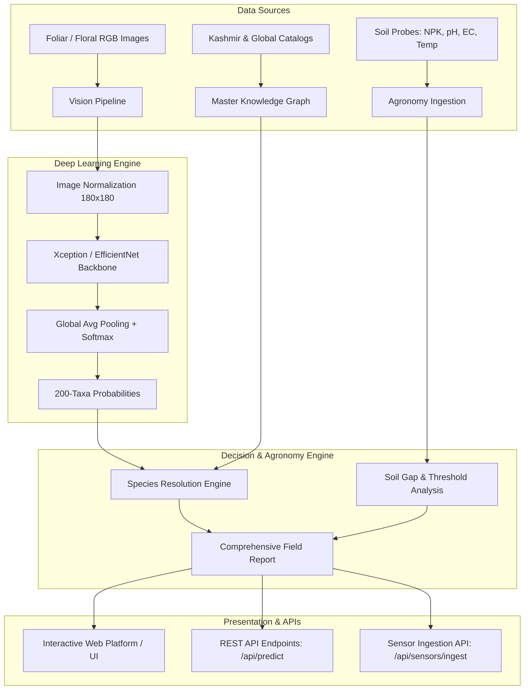

# System Architecture · Herbalist AI

## 1. High-Level Architectural Overview

Herbalist AI is designed as a modular, enterprise-grade research framework that bridges **computer vision for botanical taxa classification**, **pharmacognosy/phytochemical knowledge synthesis**, and **precision agronomic soil monitoring**.

---

## 2. Component Subsystems

### 2.1 Core Computational Framework (`src/herbalist/core/`)
- **`config.py`**: Central YAML loading with environment variable overrides.
- **`constants.py`**: Botanical taxonomy dictionaries (200 VNPlant classes, 15 Kashmir high-altitude taxa).
- **`exceptions.py`**: Custom domain exceptions for corrupt images, hardware errors, and schema mismatches.
- **`reproducibility.py`**: Deterministic seeding across Python, NumPy, TensorFlow, and PyTorch.

### 2.2 Hardware & Accelerator Subsystem (`src/herbalist/hardware/`)
- Detects host capabilities: Apple Silicon Metal (MPS), NVIDIA CUDA, multi-core CPU.
- Dynamically throttles batch sizes based on RAM availability to prevent out-of-memory (OOM) failures.

### 2.3 Data Engineering Subsystem (`src/herbalist/data/`)
- **Manifest Verification**: Cryptographic SHA-256 verification of datasets.
- **Image Preprocessing**: Aspect-ratio preserving resizing, standard ImageNet normalization.
- **Feature Engineering**: Genus extraction, toxicity ordinals, soil NPK balance ratios.
- **Deduplication**: Perceptual difference hashing (`dHash`) and MD5 deduplication.

### 2.4 Model Subsystem (`src/herbalist/models/`)
- **Classical Models**: Random Forest, Gradient Boosting, SVM, Logistic Regression.
- **Deep Neural Networks**: Transfer learning backbones (Xception, MobileNetV3, EfficientNetB0) and Tabular MLPs.
- **Ensembles**: Weighted soft-voting ensembles combining visual and agronomic predictions.

### 2.5 Monitoring & Telemetry Subsystem (`src/herbalist/monitoring/`)
- Application, training, hardware, and error logs stored under `logs/`.
- Experiment runs recorded to `experiments/experiment_registry.csv`.
