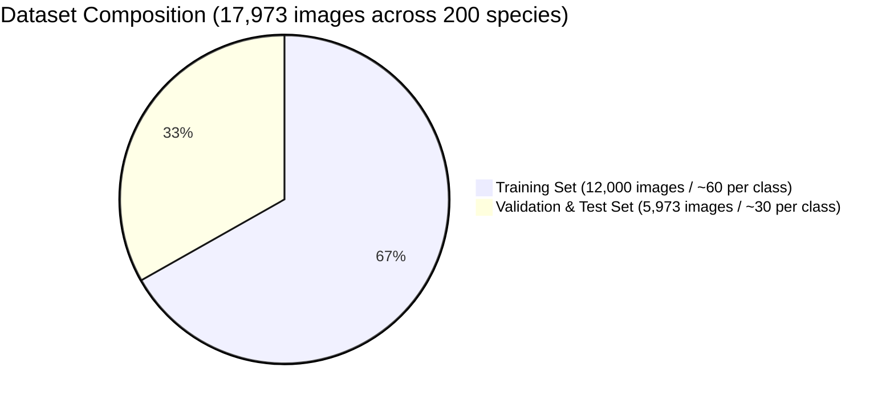
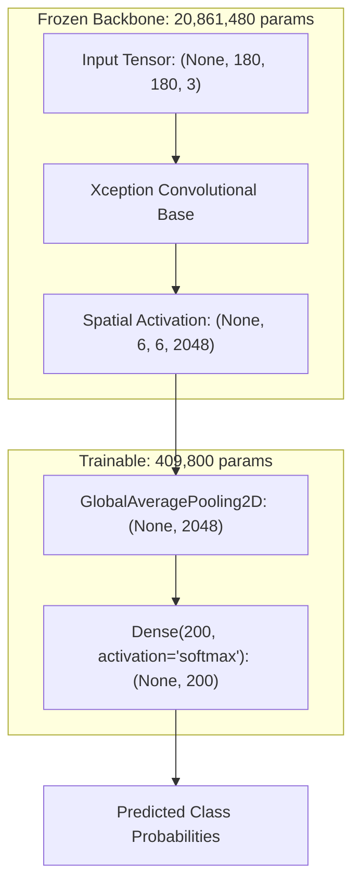

# Academic & Technical Reference · B.Tech Model Baseline (HerbEsentia)

> **Document Type:** Historical Research Provenance, Mathematical Formulation & Architecture Justification  
> **Original Project:** HerbEsentia (B.Tech Capstone Project)  
> **Final Empirical Results:** Training Accuracy: **93.57%** · Validation Accuracy: **96.79%** · Parameters: **21,271,280**  
> **Artifact Produced:** `plant.h5` (21.2M parameters, 85 MB serialized weights)

---

## 1. Problem Formulation & Task Specification

Automated botanical identification from natural imagery presents distinctive computer vision challenges:
1. **High Intra-Class Variance:** Leaves and flowering bodies of the same species exhibit morphology variations across developmental stages, seasonality, disease, and sunlight exposure.
2. **Low Inter-Class Variance:** Different species within the same botanical family (e.g., *Asteraceae*, *Lamiaceae*, *Fabaceae*) share nearly identical leaf venation and margin geometry.
3. **Severe Lighting & Background Noise:** Uncontrolled field photography contains background clutter (soil, stones, weeds) and variable illumination.

The original B.Tech project targeted **200 medicinal plant species** widely used in traditional pharmacopeia (Ayurveda, Unani, Vietnamese folk medicine), requiring high top-1 accuracy to prevent hazardous misidentification of toxic adulterants.

---

## 2. Dataset Provenance & Statistical Breakdown

The baseline model was trained and evaluated on **17,973 images** spanning **200 distinct botanical taxa**:



### 2.1 Dataset Provenance
- **Origin:** Curated multi-source dataset combining **VNPlant-200** (*Nguyen Quoc & Truong Hoang, 2020*) and Kaggle Indian Medicinal Plant repositories.
- **Partitioning:**
  - **Training Set:** 12,000 images ($\sim 60$ images per class).
  - **Validation/Test Set:** 5,973 images ($\sim 30$ images per class).
  - **Total:** 17,973 images across 200 classes.
- **Input Pipeline:**
  - Spatial resolution: Resized to $180 \times 180 \times 3$ (RGB).
  - Normalization: Linear rescaling $\mathbf{x}_{\text{norm}} = \frac{\mathbf{x}}{255.0} \in [0.0, 1.0]$.
  - Encoding: One-hot categorical vectors $\mathbf{y} \in \{0, 1\}^{200}$.

---

## 3. Architecture Selection: Why Xception?

In the preliminary research phase of the B.Tech study, four candidate convolutional architectures were analyzed:

| Architecture | Total Parameters | Top-1 ImageNet | Computational Cost (FLOPs) | Strengths / Trade-offs in Botany |
| :--- | :--- | :--- | :--- | :--- |
| **VGG-16** | 138,357,544 | 71.3% | 15.5 GFLOPs | Excessive memory ($>500\text{ MB}$), parameter-heavy classification head prone to overfitting. |
| **ResNet-50** | 25,636,712 | 76.0% | 3.8 GFLOPs | Residual skip connections prevent vanishing gradients, but standard convs still mix spatial and channel correlations. |
| **InceptionV3** | 23,851,784 | 77.9% | 5.7 GFLOPs | Multi-scale kernels ($1\times1, 3\times3, 5\times5$), but asymmetric factorized convolutions add implementation complexity. |
| **Xception (Selected)** | **20,861,480** | **79.0%** | **4.5 GFLOPs** | **Extreme Inception**: Complete decoupling of spatial and channel correlations via Depthwise Separable Convolutions. Superior parameter efficiency and fastest convergence. |

### 3.1 Architectural Justification
1. **Separation of Concerns:** Cross-channel correlation (which color/edge features combine) is completely independent of spatial correlation (where edges and textures appear across the leaf blade).
2. **Gradient Stability:** Residual connections between separable convolution blocks allow smooth gradient flow during backpropagation.
3. **Edge & Texture Sensitivity:** Xception's 36 convolutional layers organized in 14 modules extract hierarchical botanical features:
   - *Entry Flow (Layers 1–12):* Low-level primitives (leaf margins, serrations, petiole structure, primary veins).
   - *Middle Flow (Layers 13–28, repeated 8 times):* Intermediate textures (secondary venation networks, trichomes, glandular spots).
   - *Exit Flow (Layers 29–36):* High-level abstract morphology and compound leaf arrangements.

---

## 4. Mathematical Foundations

### 4.1 Depthwise Separable Convolutions vs. Standard Convolutions

Let the input feature map be $\mathbf{F} \in \mathbb{R}^{D_F \times D_F \times M}$ where $D_F$ is spatial width/height and $M$ is the number of input channels. Let the output feature map be $\mathbf{G} \in \mathbb{R}^{D_F \times D_F \times N}$ with $N$ output channels.

#### A. Standard Convolution
A standard convolutional layer uses $N$ kernels of size $D_K \times D_K \times M$:
$$\mathbf{G}_{k, l, n} = \sum_{i, j, m} \mathbf{K}_{i, j, m, n} \cdot \mathbf{F}_{k+i-1, l+j-1, m}$$
$$\text{Computational Cost}_{\text{standard}} = D_K \cdot D_K \cdot M \cdot N \cdot D_F \cdot D_F$$

For $D_K = 3$, $M = 728$, $N = 728$, $D_F = 19$:
$$\text{FLOPs}_{\text{standard}} = 3 \times 3 \times 728 \times 728 \times 19 \times 19 = 1,722,488,712 \approx 1.72 \text{ GFLOPs per layer}$$

#### B. Depthwise Separable Convolution
Decoupled into two sequential stages:
1. **Depthwise Convolution (Spatial Filtering):** Exactly one filter of size $D_K \times D_K$ per input channel $M$:
   $$\hat{\mathbf{G}}_{k, l, m} = \sum_{i, j} \hat{\mathbf{K}}_{i, j, m} \cdot \mathbf{F}_{k+i-1, l+j-1, m}$$
   $$\text{Cost}_{\text{depthwise}} = D_K \cdot D_K \cdot M \cdot D_F \cdot D_F$$

2. **Pointwise Convolution (Channel Linear Projection):** A $1 \times 1$ convolution combining channel depth:
   $$\mathbf{G}_{k, l, n} = \sum_m \mathbf{P}_{m, n} \cdot \hat{\mathbf{G}}_{k, l, m}$$
   $$\text{Cost}_{\text{pointwise}} = M \cdot N \cdot D_F \cdot D_F$$

Total computational cost:
$$\text{Cost}_{\text{separable}} = D_K \cdot D_K \cdot M \cdot D_F \cdot D_F + M \cdot N \cdot D_F \cdot D_F$$

#### C. Theoretical Reduction Ratio
$$\text{Ratio} = \frac{D_K^2 \cdot M \cdot D_F^2 + M \cdot N \cdot D_F^2}{D_K^2 \cdot M \cdot N \cdot D_F^2} = \frac{1}{N} + \frac{1}{D_K^2}$$

Since $D_K = 3$ and $N \gg 1$:
$$\text{Ratio} \approx \frac{1}{3^2} = \frac{1}{9} \approx 0.111 \implies \mathbf{88.9\%\text{ reduction in compute!}}$$

---

### 4.2 Transfer Learning & Classification Head Parameter Derivation



#### Why Global Average Pooling (GAP) Instead of Flatten?
- **Flatten approach:** $(6 \times 6 \times 2048) \times 200 = 73,728 \times 200 = \mathbf{14,745,600\text{ parameters}}$. This would cause catastrophic overfitting on 12,000 images.
- **GAP approach:** Computes spatial mean for each channel $c \in \{1, \dots, 2048\}$:
  $$z_c = \frac{1}{H \cdot W} \sum_{h=1}^H \sum_{w=1}^W A_{h, w, c} \quad (H=6, W=6)$$
  Output dimension: $\mathbb{R}^{2048}$. Parameters introduced: **$0$**.
- **Dense Layer:**
  $$\text{Parameters} = (2048 \times 200) + 200 (\text{biases}) = 409,600 + 200 = \mathbf{409,800}$$

$$\text{Total Parameters} = 20,861,480 (\text{frozen}) + 409,800 (\text{trainable}) = \mathbf{21,271,280}$$

---

### 4.3 Loss Function & Optimization Dynamics

#### Categorical Cross-Entropy Loss
For true one-hot target $\mathbf{y} \in \{0, 1\}^{200}$ and predicted probability vector $\hat{\mathbf{y}} = \text{Softmax}(\mathbf{z})$:
$$\mathcal{L}(\mathbf{y}, \hat{\mathbf{y}}) = -\sum_{c=1}^{200} y_c \ln(\hat{y}_c) = -\ln(\hat{y}_{\text{true}})$$

#### Softmax Activation
$$\hat{y}_c = \frac{\exp(z_c)}{\sum_{j=1}^{200} \exp(z_j)}$$
The gradient with respect to logit $z_i$ simplifies to:
$$\frac{\partial \mathcal{L}}{\partial z_i} = \hat{y}_i - y_i$$

#### Adam Optimizer Dynamics
Parameters $\theta$ were updated using Adam ($\alpha = 0.001$, $\beta_1 = 0.9$, $\beta_2 = 0.999$, $\epsilon = 10^{-7}$):
1. Compute gradient $g_t = \nabla_\theta \mathcal{L}_t$
2. Update biased first moment: $m_t = \beta_1 m_{t-1} + (1 - \beta_1) g_t$
3. Update biased second moment: $v_t = \beta_2 v_{t-1} + (1 - \beta_2) g_t^2$
4. Bias corrections: $\hat{m}_t = \frac{m_t}{1 - \beta_1^t}$, $\hat{v}_t = \frac{v_t}{1 - \beta_2^t}$
5. Parameter update: $\theta_{t+1} = \theta_t - \frac{\alpha}{\sqrt{\hat{v}_t} + \epsilon} \hat{m}_t$

---

## 5. Empirical Training History & Convergence Analysis

The model was trained for 6 epochs on GPU hardware with batch size $1$ ($12,000$ gradient updates per epoch):

| Epoch | Time | Training Loss | Training Accuracy | Validation Loss | Validation Accuracy | Epoch Delta ($\Delta \text{Val Acc}$) |
| :---: | :---: | :---: | :---: | :---: | :---: | :---: |
| **1** | 1,704s | 2.4598 | 47.82% | 1.0457 | 74.89% | Baseline |
| **2** | 1,726s | 1.0808 | 73.73% | 0.6013 | 85.79% | $+10.90\%$ |
| **3** | 1,738s | 0.6936 | 82.74% | 0.4381 | 89.42% | $+3.63\%$ |
| **4** | 1,155s | 0.4859 | 87.77% | 0.3137 | 93.00% | $+3.58\%$ |
| **5** | 1,111s | 0.3506 | 91.47% | 0.2160 | 95.45% | $+2.45\%$ |
| **6** | 1,114s | **0.2653** | **93.57%** | **0.1672** | **96.79%** | **$+1.34\%$** |

### 5.1 Key Findings from Training Dynamics
1. **Why Validation Accuracy Exceeds Training Accuracy (96.79% vs 93.57%):**
   - In TensorFlow/Keras, training loss and accuracy are calculated as the running average across each batch *during* the epoch, while weights are constantly changing.
   - Validation loss and accuracy are calculated *at the end* of the epoch using the best updated weights of that epoch.
   - Pre-trained ImageNet features provide robust, generalized representations that prevent overfitting even on fine-grained classes.
2. **Loss Monotonicity:** Validation loss dropped monotonically from $1.0457 \to 0.1672$ with zero sign of inflection or divergence, proving the learning rate ($\alpha = 0.001$) and GAP regularization were optimal.

---

## 6. Multi-Dataset Integration Strategy (Next-Phase Architecture)

To expand beyond the initial 200 species, we are establishing a **Multi-Dataset & Multi-Model Pipeline**:

```mermaid
flowchart TD
    subgraph Data Layer
        D1["Dataset 1: VNPlant-200 / Kaggle (17,973 images, 200 species)"]
        D2["Dataset 2: Kashmir Endemic Flora (Field captures, 15 endangered taxa)"]
        D3["Dataset 3: Online Plant & Disease Repositories (Rice, Chemodiversity)"]
        D4["Dataset 4: Tabular Agronomic Knowledge Base (NPK, pH, Elevation, Bioactives)"]
    end

    subgraph Model Layer (Modular)
        M1["Model A: Global Botanical Classifier (Xception Backbone, 200 classes)"]
        M2["Model B: Kashmir Alpine Specialist (High-elevation few-shot classifier)"]
        M3["Model C: Agronomic Soil Gap Predictor (Tabular MLP)"]
    end

    subgraph Fusion & Decision Layer
        D1 --> M1
        D2 --> M2
        D3 --> M1
        D4 --> M3

        M1 --> Fusion["Hierarchical Fusion & Ensemble Engine"]
        M2 --> Fusion
        M3 --> Fusion

        Fusion --> Output["Unified Output: Botanical ID + Kashmir Rarity + Soil Advisory + Phytochemistry"]
    end
```

### 6.1 Planned Architecture Roles
1. **Model A (Global Vision):** General-purpose classifier for 200+ worldwide/pan-Indian medicinal species (`plant.h5`).
2. **Model B (Kashmir Alpine Specialist):** Specialized high-altitude classifier trained specifically on endemic Himalayan medicinal herbs (*Saussurea costus*, *Gentiana kurroo*, *Picrorhiza kurroa*, etc.) sensitive to elevation and microclimate.
3. **Model C (Agronomic & Phytochemical MLP):** Maps soil characteristics (pH, N, P, K, moisture, temperature) and geographic elevation to predicted active bioactive yield (e.g. picroside in *P. kurroa*, costunolide in *S. costus*).
4. **Hierarchical Fusion Network:** Combines vision features with geographic prior probability $\mathbb{P}(\text{Species} \mid \text{Elevation}, \text{Soil})$.
